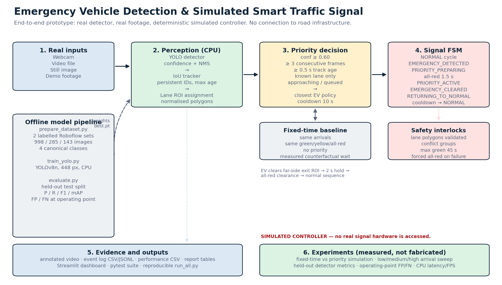
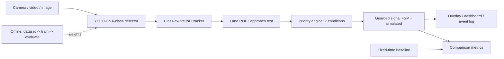

# Emergency Vehicle Detection & Simulated Smart Traffic Signal

A complete, CPU-only research prototype that **detects ambulances, fire engines, police
vehicles and normal vehicles in real footage**, tracks them across a calibrated four-way
intersection, and gives a **simulated** traffic signal a protected priority green.

The same codebase contains the dataset audit, the detector training and held-out evaluation,
a deterministic fixed-time vs priority experiment, a Streamlit dashboard, 34 automated tests,
and a full conference-paper package with every figure and table generated from real artifacts.

> **SIMULATED PROTOTYPE — NOT ROAD-DEPLOYED.**
> The signal controller is software only. It is not connected to, and has not been validated
> on, real traffic infrastructure. Nothing here supports a real-world safety, response-time,
> emissions or congestion claim. Do not use it to drive a real traffic light.



---

## Table of contents

1. [What this project is](#1-what-this-project-is)
2. [Results at a glance](#2-results-at-a-glance)
3. [How it works](#3-how-it-works)
4. [Technology choices and why](#4-technology-choices-and-why)
5. [Repository layout](#5-repository-layout)
6. [Quick start](#6-quick-start)
7. [Dataset](#7-dataset)
8. [Evaluation protocol and honesty rules](#8-evaluation-protocol-and-honesty-rules)
9. [Conference paper package](#9-conference-paper-package)
10. [Tests](#10-tests)
11. [What is not included in this repository](#11-what-is-not-included-in-this-repository)
12. [Limitations and non-claims](#12-limitations-and-non-claims)
13. [Licence and attribution](#13-licence-and-attribution)

---

## 1. What this project is

Emergency vehicles lose time at signalised intersections. Camera-based priority is attractive
because it needs no transmitter in the vehicle: a camera watches the approach, a detector
recognises the vehicle class, and the controller re-phases the signal.

This project implements that chain end to end:

- **Perception** — a custom four-class YOLOv8n detector, a class-aware IoU tracker, and
  normalised polygon lane/exit zones. A vehicle outside a calibrated approach is `UNKNOWN`
  and can never trigger priority.
- **Decision** — an emergency request is confirmed only after seven conditions hold
  (emergency class, confidence ≥ 0.60, 3 consecutive frames, track age ≥ 0.5 s, known lane,
  approaching or queued, controller free). One EV owns priority at a time.
- **Control** — a guarded finite-state machine: normal cycle → all-red preparation → protected
  priority green → exit-based release → clearance all-red → restoration → 10 s cooldown.
  A 45 s cap and a fail-safe all-red state bound the behaviour.
- **Evaluation** — a held-out detector test (including a near-duplicate leakage screen) and a
  deterministic signal-level experiment that runs the fixed-time baseline and the priority
  controller on the **same arrival list**.
- **Interfaces** — CLI runner for webcam/video/image/demo footage, Streamlit dashboard,
  interactive lane-calibration tool, pytest suite, and a one-command reproducibility runner.

The point of the project is not only to make priority work, but to **measure it honestly**:
report what it costs normal traffic, show events where priority is slower, and check whether
the detector's test frames were really unseen.

---

## 2. Results at a glance

All numbers below come from committed artifacts under `results/` and
`conference_package/experiments/`, and are regenerated by scripts. Nothing is hand-typed.

### 2.1 Detector

| Protocol | Images | Boxes | Precision | Recall | F1 | mAP@50 | mAP@50-95 |
|---|---:|---:|---:|---:|---:|---:|---:|
| Full held-out test split | 143 | 226 | 0.985 | 0.982 | 0.984 | 0.989 | 0.660 |
| **Near-duplicate-screened** | **56** | **133** | **0.941** | **0.956** | **0.949** | **0.953** | **0.636** |

At the controller's operating point (`conf = 0.55`, `IoU ≥ 0.50`), the screened split gives
129 TP, 4 FP, 4 FN — precision = recall = F1 = **0.970**. The screened result is the one the
paper treats as primary.

Why two rows? The committed test split contained consecutive video frames split across
train/val and test. The exact-duplicate check (SHA-1) found nothing, but a perceptual-hash
audit flagged 77 test images; an independent dHash pass flagged 81; their union removes
**87 of 143**. Leakage is concentrated in emergency classes: police test instances drop
57 → 10, ambulance 73 → 34, fire engine 20 → 17. Reporting 0.985 without this screen would
overstate the detector.

### 2.2 Simulated signal control

600 s, seed 42, 287 vehicles, 5 emergency vehicles, identical arrivals for both controllers:

| Metric | Fixed-time baseline | Emergency priority | Change |
|---|---:|---:|---:|
| Emergency mean wait | 10.00 s | **3.50 s** | −6.50 s (−65%) |
| Emergency max wait | 26.00 s | **3.50 s** | −22.50 s |
| Normal mean wait | 9.71 s | 8.97 s | −0.74 s |
| Normal max wait | 28.17 s | 52.61 s | **+24.44 s** |
| Emergency vehicles served | 5/5 | 5/5 | — |
| Throughput | 1,704 veh/h | 1,710 veh/h | +6 (noise) |
| Priority activations | 0 | 5 | — |

Per event the change is **−4.5, +3.5, +3.5, −22.5, −12.5 s**. Priority is not uniformly
better: two EVs that had a green in the baseline met a red in the shifted priority cycle and
paid the fixed 3.5 s confirmation + preparation cost. The mean is carried by the two
red-arrival events. Normal-traffic **maximum** wait more than doubles even though its mean
falls — a distributional cost that a mean-only report would hide.

A density sweep (low/medium/high, seeds 42–44) reproduces the emergency benefit and shows the
normal-traffic cost is density-dependent. See
[`results/report_tables.md`](results/report_tables.md) and
[`conference_package/tables/table8_density_sweep.md`](conference_package/tables/table8_density_sweep.md).

---

## 3. How it works



### 3.1 Priority confirmation

A request is created only when **all** of these hold:

1. the class is `ambulance`, `fire_engine` or `police_vehicle`;
2. detection confidence ≥ 0.60;
3. the same track is confidently detected for 3 consecutive processed frames;
4. the track is at least 0.5 s old;
5. the bounding-box centre lies inside a calibrated approach polygon;
6. the normalised distance to the junction centre is decreasing over an 8 s window, **or**
   the vehicle is queued within 0.42 normalised distance;
7. the controller is `NORMAL`, outside cooldown, and no other EV owns priority.

Among simultaneous candidates the default policy is `closest`; `confidence` and `arrival`
policies are also implemented. A single high-confidence frame cannot re-phase the signal.

### 3.2 Signal FSM

```text
NORMAL ──confirmed request──► EMERGENCY_DETECTED
                                  │
                 approach green?  ├──────────────► PRIORITY_ACTIVE
                                  │                    │
                                  └─► PRIORITY_PREPARING┘
                                      (all-red ≥ 1.5 s)
                                                       │ exit ROI + 2 s hold
                                                       ▼
                                              EMERGENCY_CLEARED
                                                       │ all-red clearance
                                                       ▼
                                              RETURNING_TO_NORMAL ──► NORMAL
```

Invariants enforced in code: no two conflicting green groups; illegal jumps raise
`InvalidTransition`; protected green only for the selected approach; 45 s maximum priority;
10 s cooldown; release always passes through all-red; any exception forces `FAIL_SAFE`
(all red) and requires an explicit reset.

### 3.3 Waiting-time definition

```text
arrival_time  = first confident detection assigned to an approach lane
waiting_time  = priority green onset − arrival_time
baseline_wait = next fixed-time green for the same lane and arrival − arrival_time
```

The baseline uses the **same** controller durations and the **same** arrival times, so the
comparison is like-for-like. The baseline is an idealised fixed-time plan, not a
field-optimised signal plan.

See [`docs/ARCHITECTURE.md`](docs/ARCHITECTURE.md) for components and state diagrams, and
[`docs/METHODOLOGY.md`](docs/METHODOLOGY.md) for metric definitions.

---

## 4. Technology choices and why

| Technology | Used for | Why this choice |
|---|---|---|
| **Python 3.14** | Entire project | Fast iteration, first-class CV/ML ecosystem, readable research code. Tested on 3.14.5; newer compatible versions work. |
| **Ultralytics YOLOv8n** | Four-class detection | Small enough for CPU inference (3.01 M parameters, 8.1 GFLOPs) and simple to fine-tune. A custom checkpoint is required because COCO has no ambulance/fire-engine class. |
| **PyTorch (CPU)** | Training and inference | Works without a GPU; `device: auto` uses CUDA/MPS when available. Reported run is CPU-only so results are reproducible on a laptop. |
| **OpenCV** | Video I/O, drawing, ROI overlay | Mature, dependency-light, handles webcam/video/image uniformly. |
| **Custom IoU tracker** | Persistent vehicle IDs | No compiled `lap` dependency, deterministic, and easy to unit-test. ByteTrack/BoT-SORT are selectable but require `lap`; they were **not** used in the reported run. |
| **Normalised polygon ROIs** | Lane and exit assignment | Camera-agnostic after calibration; auditable YAML; a detection outside every polygon is `UNKNOWN` and cannot trigger priority. |
| **Guarded FSM** | Signal control | Explicit legal states, all-red transitions, timeout and fail-safe are easier to test and argue about than ad-hoc `if` logic. |
| **Signal-level simulator** | Fixed-time vs priority experiment | Deterministic, fast, and uses the same arrival list for both controllers. It is **not** a microsimulation (no queues/spillback). |
| **Streamlit** | Dashboard | A usable multi-tab UI without a frontend build step; shares the same pipeline class as the CLI. |
| **pytest** | Automated verification | 34 tests cover FSM transitions, priority lifecycle, lane geometry, tracker and simulation accounting. |
| **JSON/CSV artifacts** | Results | Machine-readable, diffable, and consumed directly by the report and paper generators. No result is copied by hand. |
| **Matplotlib** | Figures | Headless (`Agg`) generation for reproducible plots at 300 dpi. |

Deliberate non-choices: no cloud service, no database, no compiled tracking extension, no GPU
requirement. The project is meant to install and run locally.

---

## 5. Repository layout

```text
emergency-vehicle-smart-signal/
├── main.py                       # webcam / video / image / demo runner
├── simulation.py                 # fixed-time vs priority experiment CLI
├── run_all.py                    # validate + evaluate + simulate + test + report
├── dashboard/app.py              # Streamlit dashboard
├── config/
│   ├── config.yaml               # model, priority, signal, simulation settings
│   └── intersection.yaml         # lane/exit polygons and conflict groups
├── src/
│   ├── detection/                # YOLO wrapper + IoU tracker
│   ├── traffic/                  # geometry, lane assignment, density
│   ├── control/                  # priority engine, signal FSM, simulation
│   ├── evaluation/               # detection metrics, latency, comparison
│   ├── visualization/            # overlay and signal rendering
│   └── utils/                    # config, events, logging, video I/O
├── scripts/                      # dataset prep/audit, training, evaluation, reports
├── tools/calibrate_lanes.py      # interactive polygon editor
├── tests/                        # 34 pytest tests
├── data/
│   ├── dataset/                  # data.yaml + metadata.csv (images/labels not committed)
│   └── samples/                  # small demo images
├── models/yolo/                  # checkpoints (not committed)
├── results/                      # measured artifacts, figures, tables, logs
├── docs/                         # architecture, datasets, methodology, limitations
├── conference_package/           # full paper, 14 figures, 9 tables, audits, scripts
└── notebooks/analysis.ipynb      # result inspection
```

---

## 6. Quick start

### 6.1 Install

```bash
git clone https://github.com/dti-tech-hub/chaitanyaSri.git
cd chaitanyaSri
python -m venv .venv
# Windows: .venv\Scripts\activate
# Linux/macOS: source .venv/bin/activate
python -m pip install -r requirements.txt
```

Tested environment: Python 3.14.5, CPU-only PyTorch 2.14.1, Ultralytics 8.4.174, OpenCV 5.0.0
on Windows 10/11. CUDA is optional and detected automatically.

### 6.2 What runs without the dataset or weights

- `python -m pytest -q` — full test suite.
- `python simulation.py --sweep --seeds 42,43,44` — signal-level experiment.
- `python scripts/generate_results.py` — rebuild result tables from committed artifacts.
- `streamlit run dashboard/app.py` — comparison, dataset and method tabs.
- `python conference_package/scripts/make_paper_assets.py` — rebuild all paper figures/tables.

Detection needs the model weights and the dataset images (see Section 11).

### 6.3 With weights and data

```bash
# 1. Verify the dataset
python scripts/validate_dataset.py

# 2. Evaluate the checkpoint on the held-out test split
python scripts/evaluate.py

# 3. Run the signal-level comparison and density sweep
python simulation.py --sweep --seeds 42,43,44

# 4. Run live detection on bundled demo footage
python main.py --source demo --max-frames 400 --no-display --save-video

# 5. Any video or image
python main.py --source video --input path/to/clip.mp4 --save-video
python main.py --source image --input data/samples/ambulance_1.jpg
python main.py --source webcam --camera 0

# 6. Dashboard
streamlit run dashboard/app.py

# 7. End-to-end check
python run_all.py --check-dashboard
```

Press `q` or `Esc` to stop the OpenCV window. `--hide-lanes` removes the ROI overlay;
`--confidence` overrides the detector threshold.

For a new camera, calibrate the lanes first:

```bash
python tools/calibrate_lanes.py --source "path/to/frame_or_video.mp4"
```

The tool writes `config/intersection.yaml`. An EV outside a calibrated approach is never
assigned a lane and never triggers priority.

---

## 7. Dataset

The detector was trained only on labelled real images from two public Roboflow Universe
projects, both **CC BY 4.0**:

| Source | Original classes | Licence |
|---|---|---|
| [`emergency-vehicle-crigt`](https://universe.roboflow.com/jd-s39ap/emergency-vehicle-crigt/dataset/1) | ambulance, fire brigade, police | CC BY 4.0 |
| [`vehicle-detc.`](https://universe.roboflow.com/emergency-vehicle-detection-sabir/vehicle-detc./dataset/1) | ambulance, fire-truck, vehicle | CC BY 4.0 |

Canonical four-class scheme: `ambulance`, `fire_engine`, `police_vehicle`, `normal_vehicle`.

| Split | Images | Boxes | Ambulance | Fire engine | Police | Normal |
|---|---:|---:|---:|---:|---:|---:|
| Train | 998 | 1,719 | 563 | 132 | 344 | 680 |
| Val | 285 | 501 | 148 | 35 | 116 | 202 |
| Test | 143 | 226 | 73 | 20 | 57 | 76 |

Preparation (`scripts/prepare_dataset.py`) merges the sources, remaps classes, preserves split
membership, drops exact SHA-1 duplicates, prefixes filenames with the source, and records
source path, SHA-1, box count and empty-label flag in `data/dataset/metadata.csv`.

**Known data limitations:** fire engines are scarce (20 test boxes, 17 after screening);
the two sources differ in camera, country and annotation style; `normal_vehicle` is not a
complete road-user taxonomy; labels are boxes, not tracks. The Open Images subset was excluded
because its annotations contained only ambulance boxes. Full details and required attribution
text: [`docs/DATASETS.md`](docs/DATASETS.md).

---

## 8. Evaluation protocol and honesty rules

1. **Held-out test split is never used** for training, early stopping, threshold tuning or lane
   calibration.
2. **Two detector protocols are reported**: the full test split and a near-duplicate-screened
   split. The screen removes 87 of 143 test images (union of a committed perceptual-hash audit
   and a reproducible dHash pass). The screened result is primary.
3. **Both mAP and a fixed operating point are reported.** mAP at `conf = 0.001` ranks
   detections; the controller runs at `conf = 0.55` with priority confirmation at `0.60`.
4. **The baseline is not chosen to lose.** Both controllers use the same green/yellow/all-red
   durations and the same arrivals. All five events are reported, including two where priority
   is 3.5 s slower.
5. **Simulation is labelled simulation.** No claim is made about real traffic flow, safety,
   emissions or response times.
6. **Missing experiments are labelled "Not evaluated"**, never filled with plausible values.
   There is currently no completed live-session performance artifact; no live FPS/latency
   number is claimed.
7. **Every table is generated** by `scripts/generate_results.py` or
   `conference_package/scripts/make_paper_assets.py` from committed JSON/CSV.

---

## 9. Conference paper package

[`conference_package/`](conference_package/) contains a complete submission kit:

- `conference_paper.md` — full paper draft (6,661 words, 234-word abstract), with architecture,
  method, leakage-screened results, per-event control analysis, threats to validity and
  references.
- `figures/` — 14 PNGs at 300 dpi, including a redrawn architecture diagram and priority FSM.
- `tables/` — 9 tables as Markdown and CSV.
- `artifacts/` and `provenance/` — self-contained evidence and both near-duplicate audits.
- `scripts/` — reproducible audit, screened evaluation, and asset generation.
- `SUBMISSION_CHECKLIST.md` — author/venue fill-ins, page-budget cuts, anonymisation, ethics.
- `TRACEABILITY.md` — every headline number mapped to its artifact and generating script.

Rebuild the whole package:

```bash
python conference_package/scripts/audit_near_duplicates.py
python conference_package/scripts/evaluate_screened.py
python conference_package/scripts/make_paper_assets.py
```

The screened evaluation writes only inside `conference_package/experiments/leakage_screened/`
and does not modify `results/`.

---

## 10. Tests

```bash
python -m pytest -q
# 34 passed
```

Coverage: legal and illegal FSM transitions, priority request/activate/release/cooldown/max
duration, lane assignment and unknown-lane fail-safe, exit detection, tracker birth/matching/
loss, simulation accounting, and comparison-table generation.

---

## 11. What is not included in this repository

GitHub is not a good home for 2.5 GB of raw video and zipped third-party data. The following
are intentionally excluded by `.gitignore`:

| Excluded | Approx. size | Why |
|---|---:|---|
| `data/raw/` | ~2.5 GB | Third-party downloads (Roboflow exports, OID CSV, demo clips) with their own licences; some exceed GitHub's file-size limit. |
| `data/dataset/images/`, `labels/` | ~68 MB | Training data is redistributable under CC BY 4.0 but is kept out to avoid a bloated repo; regenerate with `scripts/prepare_dataset.py`. |
| `models/yolo/*.pt` | ~30 MB | Ultralytics-derived weights carry their own licence; train your own or place `best.pt` locally. |
| `results/training/ev_yolo_448/` | ~107 MB | Ultralytics run directory (curves, batches, checkpoints). Summary metrics are committed. |
| `results/videos/` | ~2.6 MB | Generated annotated demos. |

What **is** committed: all code, configs, docs, result JSON/CSV, figures, the 56-image screened
test split, dataset metadata, and the paper package. The repo is therefore reproducible for the
simulation, tests, reports and paper assets without the raw data.

To restore detection capability:

1. Download the two CC BY 4.0 datasets from the links in Section 7 and arrange the raw layout
   described in `docs/DATASETS.md`.
2. Run `python scripts/prepare_dataset.py`.
3. Run `python scripts/train_yolo.py --epochs 30 --imgsz 448 --batch 16 --name ev_yolo_448`,
   or copy your own checkpoint to `models/yolo/best.pt`.
4. Run `python scripts/evaluate.py`.

Without emergency-capable weights, the pipeline still runs but deliberately disables priority
and writes a `model_warning` event. It will not treat a COCO "truck" as a fire engine.

---

## 12. Limitations and non-claims

- **Not deployed.** No traffic-light hardware, no public-road trial, no regulatory approval.
- **Signal-level simulation.** No queue spillback, saturation flow, pedestrians, cyclists,
  buses, escorts or driver behaviour. Poisson arrivals are not real traffic.
- **Small, same-source test set.** Even the screened split (56 images) comes from the same two
  collections as training. The screened score is an upper bound on cross-site performance.
- **Fire-engine scarcity.** 17 screened test boxes; per-class fire metrics have wide uncertainty.
- **Tracking is not benchmarked.** No MOT annotations, so MOTA/IDF1 are not reported; ByteTrack
  was not used because `lap` was unavailable in the reported environment.
- **Confidence is not calibrated.** 0.60 is a decision threshold, not a probability.
- **Waiting time is entangled with detection latency.** It starts at the first confident,
  lane-assigned detection, not at the physical stop line.
- **One CPU machine.** Timing is not a hardware benchmark.

Deployment would require traffic-engineering review, hardware fail-safes, cybersecurity
assessment, regulatory approval and field testing. None of that was done here.

---

## 13. Licence and attribution

- **Project code:** MIT — see [`LICENSE`](LICENSE).
- **Training data:** CC BY 4.0. If you redistribute the merged dataset, attribute both source
  projects and note the modifications listed in [`docs/DATASETS.md`](docs/DATASETS.md).
- **Ultralytics YOLOv8:** used under its own licence; check it before redistributing weights.
- **Demo clips:** retain their original licences and are **not** part of the dataset or this
  repository. Pexels-hosted clips keep the Pexels licence; compilation clips keep their
  uploaders' terms.

If you use this work, please cite the repository and the accompanying paper package:

```text
Chaitanya Sri et al. "Detection-Confirmed Emergency Vehicle Priority at a Simulated
Four-Way Intersection: Performance, Cost, and a Leakage-Screened Evaluation."
Manuscript draft, 2026. https://github.com/dti-tech-hub/chaitanyaSri
```

Questions and issues: open a GitHub issue on this repository.
