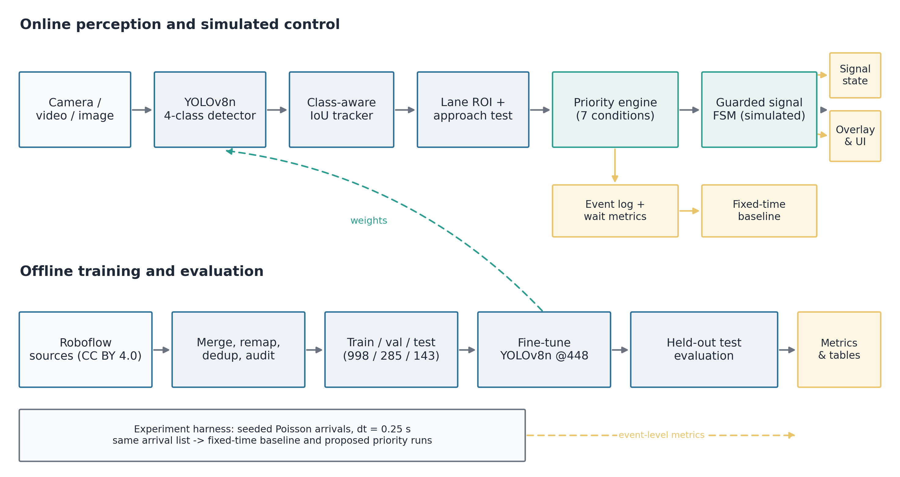
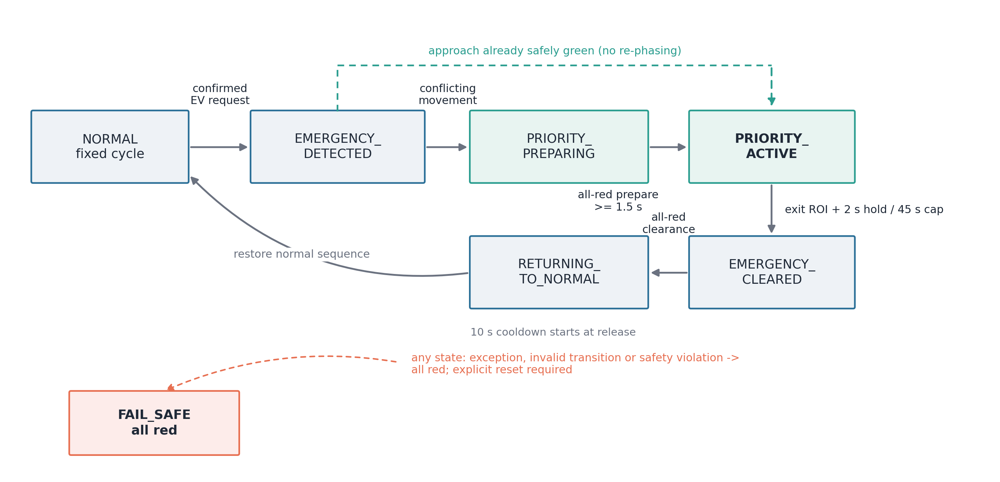
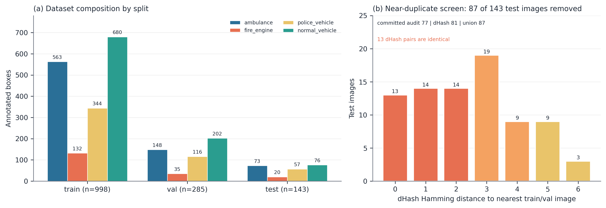
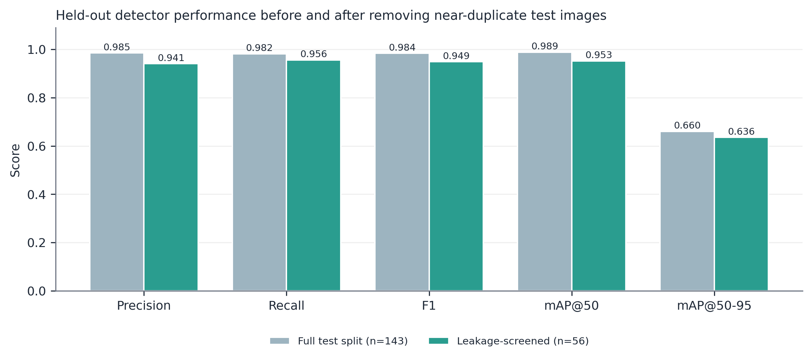
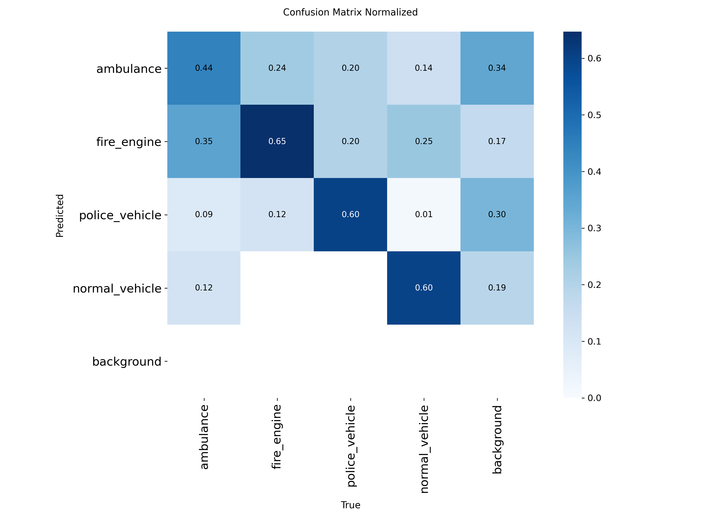
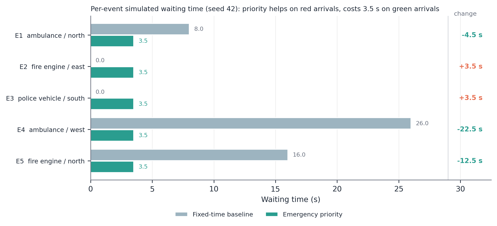
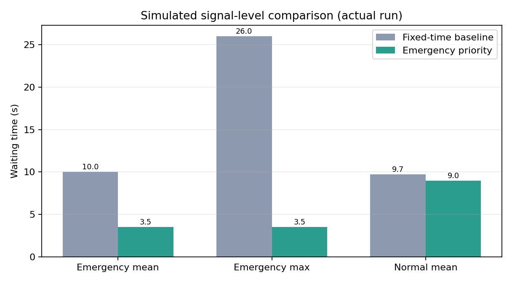

# Detection-Confirmed Emergency Vehicle Priority at a Simulated Four-Way Intersection: Performance, Cost, and a Leakage-Screened Evaluation

**[Author 1]**, **[Author 2]**, **[Author 3]**
*[Department], [Institution], [City], [Country]*
*[email addresses]*

**Target venue:** [conference name] — *[track]*
**Paper type:** full research paper (systems + empirical evaluation)
**Keywords:** emergency vehicle preemption, traffic signal control, YOLOv8, object detection, near-duplicate leakage, reproducible evaluation

---

## Abstract

Emergency vehicles lose time at signalised intersections, and camera-based priority is attractive because it needs no vehicle-side transmitter. Prototype studies often measure detector accuracy on test frames visually near-identical to training frames, and report only the average benefit of priority while hiding its cost to ordinary traffic. We present a complete, CPU-realizable prototype that detects ambulances, fire engines, police vehicles and normal vehicles, tracks them, assigns calibrated approach lanes, confirms requests over multiple frames, and drives a **simulated** four-approach signal through a guarded priority finite-state machine. The detector is a four-class YOLOv8n fine-tuned on 998 training images from two public CC BY 4.0 datasets. On the full 143-image held-out test split it reaches precision 0.985, recall 0.982, F1 0.984, mAP@50 0.989 and mAP@50-95 0.660. A provenance audit flags 77 test images as perceptual near-duplicates; an independent difference-hash pass flags 81, and their union removes 87. On the remaining 56 images the same checkpoint reaches precision 0.941, recall 0.956, F1 0.949, mAP@50 0.953 and mAP@50-95 0.636, with 0.970 precision/recall at the controller's operating threshold. In a deterministic experiment with identical arrivals, priority reduces mean emergency wait from 10.00 s to 3.50 s and maximum wait from 26.00 s to 3.50 s, while normal-traffic maximum wait rises from 28.17 s to 52.61 s; throughput is unchanged. Two of five events are slower under priority. The controller is simulated and makes no real-world safety or response-time claim.

---

## 1. Introduction

An emergency vehicle approaching a red signal must either wait or be given precedence. Traffic-signal preemption and priority have been studied for decades [1], [2], and the engineering options are well understood: send a request from the vehicle, detect it with a camera or loop, then either preempt the whole intersection or adjust the current plan. What is less well understood in the rapid-prototyping literature is how much of a reported benefit survives an honest evaluation. Two failure modes recur. First, detector accuracy is measured on frames taken from the same video sequences as the training data, so near-duplicate frames inflate precision, recall and mAP. Second, the control result is summarised as a single average, which hides the events in which the emergency vehicle already had a green and priority made it wait longer.

This paper addresses both. We build a complete prototype — detection, tracking, lane assignment, multi-frame confirmation, and a guarded priority finite-state machine — and evaluate it at two levels. The perception level is evaluated on a held-out image split, first as committed and then after a documented near-duplicate screen. The control level is evaluated in a signal-level simulator that processes the *same* arrival list twice, once with a fixed-time controller and once with the priority controller, and reports every priority event rather than only the mean.

The system is deliberately modest in its compute envelope: a YOLOv8n model at 448 × 448 on CPU, a dependency-free IoU tracker, and normalised polygon geometry. This makes the whole pipeline reproducible on a laptop, which matters for a teaching and research prototype, and it makes the negative results as informative as the positive ones.

### 1.1 Contributions

1. **An end-to-end, CPU-only pipeline** that couples a four-class emergency-vehicle detector, a class-aware IoU tracker, calibrated approach/exit polygons, a seven-condition priority confirmation rule, and a guarded signal FSM with all-red preparation, exit-based release, cooldown, maximum-green cap and a fail-safe state. The state machine has 34 automated tests covering legal and illegal transitions, priority lifecycle, lane geometry, tracking and simulation accounting.
2. **An honest perception evaluation.** We report the full held-out test result, then quantify near-duplicate leakage across splits (77 committed flags, 81 from an independent dHash pass, 87 in union) and re-evaluate the same checkpoint on the 56 remaining images. We also report the fixed-threshold operating point that the controller actually uses, because mAP at `conf = 0.001` is not the deployment operating point.
3. **A like-for-like control experiment** in which the baseline is computed from the same controller durations and the same arrival times, with full event-level disclosure. The mean emergency wait falls by 6.5 s, but two of five events are 3.5 s *worse* than the baseline, and the normal-traffic maximum wait rises by 24.4 s.
4. **A reproducible artifact trail**: every number in this paper is produced by a script from a committed JSON/CSV artifact, and the package that accompanies the paper regenerates every figure and table.

### 1.2 Scope and non-claims

The signal controller is simulated. It is not wired to a traffic light, was not tested on a public road, and does not model pedestrians, cyclists, queue spillback, saturation flow, emergency escorts or driver behaviour. The detector was trained and tested on two public image collections with limited geographic diversity. Nothing in this paper should be read as evidence of real-world safety, emissions, response-time or congestion benefit. These limits are stated again in Section 8 rather than buried in a footnote.

---

## 2. Related Work

**Emergency vehicle preemption.** The FHWA cross-cutting study [1] documents the operational options and the institutional requirements for preemption, and the more recent EVP primer [13] frames the distinction between preemption (interrupt the plan) and priority (adjust it). Qin and Khan [2] analyse transition strategies — how to return from preemption to the normal cycle without creating a secondary hazard — which is precisely the part of the problem our `RETURNING_TO_NORMAL` state and all-red clearance are designed to make explicit. Our work does not propose a new traffic-engineering policy; it contributes an implementable detection-to-signal chain and an evaluation protocol for prototypes.

**Detection.** YOLO-family detectors [3] trade accuracy for latency and are a common choice for edge deployment; YOLOv8 [4] provides anchor-free detection with a small `n` variant suitable for CPU inference. We fine-tune YOLOv8n rather than use a COCO model, because COCO has no ambulance or fire-engine class and mapping a generic "truck" to a fire engine would be unsafe. Standard detection metrics follow PASCAL VOC [9] and COCO [10] conventions; we report both mAP and a fixed operating point because emergency control is a decision problem, not a ranking problem.

**Tracking.** SORT [5] and Deep SORT [6] established the detection-plus-association pattern; ByteTrack [7] and BoT-SORT [8] improve association under occlusion and low confidence. Our default tracker is a deliberately simple class-aware IoU tracker with persistent IDs, because the optional `lap` dependency needed by ByteTrack could not be installed in the reported environment. This is a documented gap (Section 8), not a claim that IoU tracking is superior.

**Simulation.** SUMO [11] is the standard open microscopic simulator. Our experiment is deliberately *not* a microsimulation: it is a deterministic signal-level model with seeded Poisson arrivals, fixed crossing times, and two controllers sharing one arrival list. It is adequate for comparing controller logic under identical demand and inadequate for claims about queues or capacity, which we do not make.

**Positioning.** The contribution is not a new detector architecture or a new preemption policy. It is an end-to-end system with explicit safety guards, a leakage-aware evaluation, and an event-level account of both the benefit and the cost of priority.

---

## 3. System Architecture

The system has two halves that meet at the detector weights and the controller code (Fig. 1). The online path consumes camera, video, image or bundled demo input, detects and tracks vehicles, assigns lanes, confirms emergency requests, and updates the simulated signal. The offline path prepares and audits the dataset, fine-tunes the detector, and evaluates it on the held-out split. A separate experiment harness runs the signal-level comparison.



**Figure 1.** System architecture. The online path (top) and the offline training/evaluation path (bottom) share the four-class checkpoint and the controller implementation. The experiment harness reuses the same controller durations but not the detector; it isolates control logic.

### 3.1 Online perception

A detection is a bounding box, a class and a confidence. The detector wrapper maps model class names onto four canonical classes (`ambulance`, `fire_engine`, `police_vehicle`, `normal_vehicle`) through configurable aliases. If a loaded checkpoint lacks all three emergency classes, the pipeline still runs but priority activation is disabled and a `model_warning` event is written. This prevents a COCO "truck" from being treated as a fire engine.

The tracker associates detections to existing tracks by class-aware IoU (threshold 0.30), keeps a track alive for up to 30 missed frames, requires two hits before confirmation, and stores a 40-frame history. Each confirmed track exposes its recent centres, velocity, displacement over a time window, and normalised distance to the junction centre.

### 3.2 Lane geometry and approach test

`config/intersection.yaml` defines four approach polygons, four far-side exit polygons, a central junction zone, and two conflict groups (`north_south`, `east_west`). Coordinates are normalised to `[0, 1]`. A detection whose centre lies outside every approach polygon is `UNKNOWN`; it never inherits a lane from image position and cannot trigger priority. This is a deliberate fail-safe: a wrong lane must not receive a green.

Lane assignment majority-votes over the last five frames to suppress flicker. The last known lane is retained only while the vehicle is inside the central junction zone. For a new camera, an interactive tool writes the same YAML by clicking polygon vertices; the default geometry is schematic and is not a reconstruction of the demo location.

Approach is direction-agnostic. With normalised distance `d(t) = ||c(t) − c_j|| / s`, where `c(t)` is the box centre, `c_j` the junction centre and `s = 0.707` the corner scale, a vehicle is approaching if

```
d(t) − d(t − w) < −δ,   w = 8 s,   δ = 0.01
```

or if it is already queued within `d ≤ 0.42`. This avoids a fixed `x`-direction rule that fails when the camera is rotated.

---

## 4. Method

### 4.1 Priority confirmation

A request is created only when **all** of the following hold:

1. the class is one of `ambulance`, `fire_engine`, `police_vehicle`;
2. confidence ≥ 0.60;
3. the same track has been confidently detected for at least 3 consecutive processed frames;
4. the track is at least 0.5 s old;
5. the box centre lies inside a calibrated approach polygon;
6. the vehicle is approaching, or queued within the stop area (Section 3.2);
7. the controller is in `NORMAL`, outside the 10 s cooldown, and no other EV owns priority.

Among simultaneous candidates the default policy is `closest` (smallest distance to the junction); `confidence` and `arrival` policies are implemented as alternatives. Only one EV owns priority at a time; a second EV waits in arrival order. Confirmation is deliberately multi-frame and multi-signal: a single high-confidence detection cannot re-phase the intersection. The cost is a minimum detection delay of three processed frames and 0.5 s of track age, which is visible in the results.

### 4.2 Signal control

The normal cycle is built from the two conflict groups:

```
north_south green 20 s → yellow 3 s → all-red 1 s
east_west   green 20 s → yellow 3 s → all-red 1 s
```

The proposed controller is a guarded finite-state machine (Fig. 2). A confirmed request moves to `EMERGENCY_DETECTED`. If the EV's approach already has a safe green, the controller goes directly to `PRIORITY_ACTIVE`; otherwise it enters `PRIORITY_PREPARING`, forces the conflicting group through yellow and all-red, and waits at least 1.5 s before granting a protected green. When the track enters the far-side exit polygon, the controller holds green for a further 2 s, then passes through `EMERGENCY_CLEARED` and `RETURNING_TO_NORMAL` with an all-red clearance before restoring the normal sequence.



**Figure 2.** Guarded priority FSM. Dashed green: fast path when the approach is already safely green. Dashed red: any exception, invalid transition or safety violation forces all-red `FAIL_SAFE`; the controller does not silently resume.

Safety invariants are enforced in code, not only documented:

- `PRIORITY_ACTIVE` gives green only to the selected approach, or to a non-conflicting same-group movement when that approach was already green;
- an illegal jump raises `InvalidTransition`;
- the controller rejects two conflicting green groups;
- `max_priority_seconds = 45 s` forces release even if the EV is never seen leaving;
- release always passes through an all-red clearance and a visible restoration state;
- a 10 s cooldown starts at release;
- any detection, tracking or controller exception forces all lanes red and requires an explicit reset.

Table A1 (Appendix A) lists every prototype parameter. These are engineering choices for a prototype, not traffic-engineering standards.

### 4.3 Waiting-time definitions

For the live pipeline, arrival is the first confident detection assigned to an approach lane, and

```
waiting_time   = green_onset − arrival_time
baseline_wait  = next_fixed_green(lane, arrival_time) − arrival_time
```

For the simulation, arrival is the scheduled EV arrival and a fixed 2 s confirmation delay stands in for detection and tracking confirmation. Priority response time is separately defined as `green_onset − request_time`; it measures controller preparation, not perception latency. End-to-end wall-clock latency from the first lane-assigned detection to green is recorded in the live event log, but no completed live run artifact exists in the reported package, so no live latency number is claimed.

### 4.4 Simulation harness

`simulation.py` generates Poisson normal arrivals at per-lane rates, places five scheduled emergency vehicles, and advances at `dt = 0.25 s` for 600 s. Both controllers process the same arrival list. The baseline is the same `FixedTimeController` used by the live code, so its next-green calculation is consistent with the proposed controller's normal cycle.

The baseline wait for an EV arriving at `(lane, t)` is the time until the next fixed green for that lane; the proposed wait is the actual priority green onset minus `t`. Because the controllers share durations and arrivals, the comparison is like-for-like. The baseline is an idealised fixed-time plan, not a field-optimised plan.

The emergency schedule was selected before the final comparison from a sweep of candidate schedules, using the criterion "five distinct priority activations with a non-trivial baseline wait". It was not selected after inspecting the final mean to maximise the effect. The event-level table is reported in full, including events where priority loses.

### 4.5 Metrics

Detection: precision, recall, F1, mAP@50, mAP@50-95, and a fixed-threshold TP/FP/FN pass with greedy class-aware IoU matching at IoU ≥ 0.5. Control: emergency mean and maximum wait, normal mean and maximum wait, EVs served, throughput, activations, response time, and priority duration. Runtime: per-image preprocess, inference and postprocess latency. All definitions match the implementation in `src/evaluation/`.


---

## 5. Experimental Setup

### 5.1 Data

The detector was trained only on labelled real images from two public Roboflow Universe projects, both licensed CC BY 4.0 [12]: `emergency-vehicle-crigt` (workspace `jd-s39ap`, version 1) and `vehicle-detc.` (workspace `emergency-vehicle-detection-sabir`, version 1). The preparation script merges the sources, remaps their classes to the canonical four-class scheme, prefixes output filenames with the source, preserves the original split membership, drops exact duplicates by SHA-1, copies every image, rewrites every label, and records source path, SHA-1, box count and empty-label flag per output image. The canonical mapping is: source `fire brigade` and `fire-truck` → `fire_engine`; source `vehicle` → `normal_vehicle`.

**Table 1. Dataset composition after merging, class remapping and exact-duplicate removal.**

| Split | Images | Boxes | Ambulance | Fire engine | Police | Normal |
|---|---:|---:|---:|---:|---:|---:|
| Train | 998 | 1,719 | 563 | 132 | 344 | 680 |
| Val | 285 | 501 | 148 | 35 | 116 | 202 |
| Test | 143 | 226 | 73 | 20 | 57 | 76 |

*Validation status: ok — 0 corrupt images, 0 missing labels, 0 invalid boxes, 0 unknown class IDs, 0 exact duplicates. Source: `results/metrics/dataset_validation.json`.*

The Open Images subset present in the raw data was excluded: its downloaded annotations contained only ambulance boxes, so including it would have taught the model that fire engines and police vehicles do not exist. This exclusion is recorded rather than hidden. The test split was never used for training, early stopping, threshold selection or lane calibration.



**Figure 3.** (a) Class distribution by split. (b) Perceptual-hash distances from each test image to its nearest train/val image, using the reproducible dHash pass. The committed audit flags 77 images, the dHash pass flags 81, and their union removes 87 of 143 test images. Thirteen dHash pairs are identical at 64-bit resolution.

Table 1 also exposes the main data weakness: only 20 fire-engine test boxes exist, and after leakage screening only 17 remain. Any fire-engine number carries a wide uncertainty interval and should not be read as deployment-grade.

### 5.2 Training

The detector is YOLOv8n fine-tuned from COCO weights at 448 × 448, batch 16, on CPU, with the Ultralytics default optimiser settings overridden as listed in Table 2. Training ran for the full 30 requested epochs (no early stop); the best checkpoint by the Ultralytics fitness criterion (0.1·mAP@50 + 0.9·mAP@50-95) was epoch 22, with validation precision 0.971, recall 0.961, mAP@50 0.980 and mAP@50-95 0.649. The final epoch 30 reached mAP@50 0.973 and mAP@50-95 0.634. The checkpoint used for every test in this paper is the epoch-22 best checkpoint.

**Table 2. Detector training configuration and cost.**

| Field | Value |
|---|---|
| Model | YOLOv8n, 72 layers, 3,006,428 parameters, 8.1 GFLOPs |
| Input size / batch | 448 × 448 / 16 |
| Epochs / best epoch | 30 requested and completed / 22 by fitness |
| Device | CPU (13th Gen Intel Core i5-1335U) |
| Elapsed | 54,652.7 s (15 h 10 min 52 s) |
| Seed / determinism | 42 / deterministic=True |
| Optimiser | auto; lr0 = 0.001, lrf = 0.01, cosine schedule, warm-up 3 epochs |
| Augmentation | HSV (0.015/0.6/0.4), rotation 5°, translate 0.1, scale 0.5, shear 2°, horizontal flip 0.5, mosaic 0.8, mixup 0.05 |
| Patience / close mosaic | 10 / last 10 epochs |

*Source: `results/training/training_metadata.json`, `results/training/ev_yolo_448/results.csv`.*

The environment is recorded in Table A2 (Appendix A). All reported runs are CPU-only.

### 5.3 Detector evaluation protocol

Two evaluations are reported for the same checkpoint:

1. **As-committed test split** (143 images): Ultralytics validation at `conf = 0.001`, `iou = 0.60`, plus a separate fixed-threshold pass at `conf = 0.55`, `IoU ≥ 0.50` with greedy class-aware matching.
2. **Leakage-screened test split** (56 images): identical settings after removing every test image flagged by either near-duplicate audit.

The fixed-threshold pass is the operating point used by the live pipeline (`model.confidence = 0.55`); priority confirmation then applies a stricter 0.60. Reporting only mAP would hide the precision cost of the low-confidence tail, so both are reported.

### 5.4 Near-duplicate audit

The committed dataset audit checks exact duplicates by SHA-1 and found none. Exact hashing, however, cannot detect consecutive video frames that differ by compression noise or a small camera shift. A separate provenance audit was therefore run: for every test image, the nearest image in train ∪ val under a perceptual hash, with a match declared at Hamming distance ≤ 6. The committed audit (`paper/provenance/near_duplicate_audit.json`) flagged 77 of 143 test images, including 8 pairs at distance 0.

Because the script that produced the committed audit is not part of the repository, we added an independent, reproducible difference-hash pass (`conference_package/scripts/audit_near_duplicates.py`): grayscale, 9 × 8 resize with LANCZOS, 64-bit dHash from horizontal neighbour comparisons, nearest neighbour in train ∪ val, threshold ≤ 6. It flags 81 images. The two lists overlap on 71, disagree on 6 committed-only and 10 dHash-only images. The evaluation removes their **union**, 87 images, leaving 56 images and 133 boxes. This is the conservative choice: a borderline frame that either hash considers a near-duplicate is excluded.

The class composition changes sharply under screening (Table 4, "Instances"): ambulance 73 → 34, fire engine 20 → 17, police 57 → 10, normal 76 → 72. Leakage is therefore concentrated in emergency-vehicle frames, and most severely in police frames — exactly the classes a priority controller depends on.

### 5.5 Control experiment

One main run (600 s, seed 42, 287 vehicles, 5 EVs, arrivals 420/420/380/380 veh/h) and a density sweep at low (180/180/160/160), medium (same as main) and high (900/900/820/820) arrival rates with seeds 42, 43 and 44 give nine sweep runs. The emergency schedule is fixed: north ambulance at 40 s, east fire engine at 170 s, south police vehicle at 300 s, west ambulance at 430 s, north fire engine at 560 s. The simulator uses `dt = 0.25 s`, a 2 s detection-confirmation proxy, and a 6 s priority hold.

### 5.6 Software verification

The pytest suite contains 34 tests covering legal and illegal FSM transitions, the priority lifecycle (request, activation, release, cooldown, maximum duration), lane assignment and unknown-lane fail-safe, exit detection, tracker birth/matching/loss, simulation accounting and report metrics. All 34 pass in 0.83 s on the reported machine. The end-to-end runner completed with status `ok` for dataset validation, simulation and sweep, pytest, the dashboard health check and report generation; the held-out evaluation was run separately (67.5 s) and produced the artifacts used here.

---

## 6. Results

### 6.1 Detector: full test split

**Table 3. Detector performance on the full held-out test split (143 images, 226 boxes).**

| Class | Images | Instances | P | R | F1 | mAP@50 | mAP@50-95 |
|---|---:|---:|---:|---:|---:|---:|---:|
| All | 143 | 226 | 0.985 | 0.982 | 0.984 | 0.989 | 0.660 |
| Ambulance | 72 | 73 | 0.998 | 0.986 | 0.992 | 0.994 | 0.667 |
| Fire engine | 20 | 20 | 1.000 | 0.973 | 0.987 | 0.995 | 0.738 |
| Police vehicle | 57 | 57 | 0.957 | 0.982 | 0.969 | 0.984 | 0.659 |
| Normal vehicle | 23 | 76 | 0.986 | 0.987 | 0.987 | 0.982 | 0.579 |

*Source: `results/metrics/detection_metrics.json` (mAP at conf = 0.001, IoU = 0.60).*

At the controller's operating threshold (`conf = 0.55`, `IoU ≥ 0.50`), the full split gives 222 TP, 4 FP and 4 FN, i.e. precision = recall = F1 = 0.982. The corresponding 95% Wilson interval for recall is approximately [0.956, 0.993].

### 6.2 Detector: leakage-screened split



**Figure 4.** Aggregate detector scores before and after the near-duplicate screen. The screen removes 87 of 143 test images; the same checkpoint is used.

**Table 4. Detector performance after removing all near-duplicate test images (56 images, 133 boxes).**

| Class | Images | Instances | P | R | F1 | mAP@50 | mAP@50-95 |
|---|---:|---:|---:|---:|---:|---:|---:|
| All | 56 | 133 | 0.941 | 0.956 | 0.949 | 0.953 | 0.636 |
| Ambulance | 33 | 34 | 0.997 | 0.971 | 0.983 | 0.992 | 0.691 |
| Fire engine | 17 | 17 | 1.000 | 0.968 | 0.984 | 0.995 | 0.732 |
| Police vehicle | 10 | 10 | 0.784 | 0.900 | 0.838 | 0.841 | 0.539 |
| Normal vehicle | 21 | 72 | 0.985 | 0.986 | 0.986 | 0.983 | 0.582 |

*Source: `conference_package/experiments/leakage_screened/screened_metrics.json`.*

**Table 5. Fixed-threshold operating point used by the live pipeline (conf = 0.55, IoU ≥ 0.50).**

| Split | Images | Boxes | TP | FP | FN | P | R | F1 |
|---|---:|---:|---:|---:|---:|---:|---:|---:|
| Full test | 143 | 226 | 222 | 4 | 4 | 0.982 | 0.982 | 0.982 |
| Leakage-screened | 56 | 133 | 129 | 4 | 4 | 0.970 | 0.970 | 0.970 |

*Sources: `results/metrics/detection_metrics.json`, `conference_package/experiments/leakage_screened/screened_metrics.json`.*

The screen lowers aggregate mAP@50 by 3.6 points and mAP@50-95 by 2.4 points; precision falls by 4.4 points and F1 by 3.5. The loss is not uniform. Police vehicles, whose test instances fell from 57 to 10, drops 14.3 mAP@50 points and 13.1 F1 points; ambulance and fire-engine scores are essentially unchanged; normal-vehicle scores are unchanged. In other words, the decrease is concentrated in the emergency classes whose frames were most often near-duplicates, especially police. The operating point is far more stable: 4 false positives and 4 false negatives in both protocols, with precision/recall 0.970 on the screened split (95% Wilson interval for recall ≈ [0.925, 0.988]).



**Figure 13.** Normalised confusion matrix on the leakage-screened split, as produced by Ultralytics validation. Validation runs at `conf = 0.001`, so the matrix includes many low-confidence boxes and is not the controller operating point; it is included for class-level error inspection only. The operating point is reported in Table 5.

The auxiliary image-level emergency-presence ROC has AUC 1.0 on both splits, but 137/143 and 50/56 images contain an emergency vehicle. This AUC is a degenerate, auxiliary statistic and is not used as evidence of calibration.

### 6.3 Control: main comparison

**Table 6. Simulated fixed-time vs emergency-priority control (600 s, seed 42, 287 vehicles, 5 EVs).**

| Metric | Fixed-time | Priority | Change |
|---|---:|---:|---:|
| Emergency mean wait (s) | 10.00 | **3.50** | −6.50 (−65%) |
| Emergency max wait (s) | 26.00 | **3.50** | −22.50 (−86.5%) |
| Normal mean wait (s) | 9.71 | 8.97 | −0.74 (−7.6%) |
| Normal max wait (s) | 28.17 | 52.61 | +24.44 (+86.8%) |
| Emergency vehicles served | 5 / 5 | 5 / 5 | — |
| Throughput (veh/h) | 1,704 | 1,710 | +6 (+0.35%) |
| Priority activations | 0 | 5 | +5 |
| Priority response time (s) | n/a | 1.50 | — |

*Source: `results/simulation/simulation_summary.json`. Signal-level simulation only.*



**Figure 5.** Per-event waiting time for the same arrivals. Negative change favours priority; two events are 3.5 s worse because the EV arrived on a baseline green but met a red in the shifted priority cycle.

**Table 7. Event-level priority outcome (seed 42).**

| # | Class | Lane | Arrival (s) | Request (s) | Green (s) | Release (s) | Wait (s) | Baseline wait (s) | Delta | Green held (s) |
|---:|---|---|---:|---:|---:|---:|---:|---:|---:|---:|
| 1 | ambulance | north | 40.0 | 42.0 | 43.5 | 49.5 | 3.5 | 8.0 | −4.5 | 6.0 |
| 2 | fire_engine | east | 170.0 | 172.0 | 173.5 | 179.5 | 3.5 | 0.0 | +3.5 | 6.0 |
| 3 | police_vehicle | south | 300.0 | 302.0 | 303.5 | 309.5 | 3.5 | 0.0 | +3.5 | 6.0 |
| 4 | ambulance | west | 430.0 | 432.0 | 433.5 | 439.5 | 3.5 | 26.0 | −22.5 | 6.0 |
| 5 | fire_engine | north | 560.0 | 562.0 | 563.5 | 569.5 | 3.5 | 16.0 | −12.5 | 6.0 |

*Source: `results/simulation/simulation_summary.json`.*

In this run the proposed wait is identical (3.5 s) for every event because each request needed both the fixed 2.0 s confirmation proxy and the 1.5 s all-red preparation. The mean improvement is entirely due to events 4 and 5, which arrived on red in the baseline. Events 2 and 3 had a baseline wait of zero; after the first priority event shifted the cycle, they arrived on red in the proposed run and paid the 3.5 s preparation cost. This is the central honest result of the control experiment: **priority is not uniformly better at the event level, even though its average is.**

The distributional cost is also visible. Normal-vehicle mean wait falls by 0.74 s, but the maximum rises from 28.17 s to 52.61 s: pulling an EV out of sequence moves delay onto at least one conflicting movement. Throughput changes by +0.35%, which is within the variation caused by the arrival process; we make no capacity claim.



**Figure 9.** Aggregate waiting times for the main run (reproduced from the simulation artifact).

### 6.4 Arrival-rate sweep

**Table 8. Arrival-rate sweep, mean ± sample standard deviation over seeds 42, 43, 44.**

| Density | Runs | Baseline EV wait (s) | Priority EV wait (s) | Baseline normal wait (s) | Priority normal wait (s) | Baseline throughput | Priority throughput | Priority events |
|---|---:|---:|---:|---:|---:|---:|---:|---:|
| Low | 3 | 10.00 ± 0.00 | 3.50 ± 0.00 | 8.72 ± 0.13 | 7.42 ± 0.88 | 724 ± 56 | 714 ± 52 | 15 |
| Medium | 3 | 10.00 ± 0.00 | 3.50 ± 0.00 | 8.50 ± 1.07 | 8.53 ± 0.46 | 1,682 ± 130 | 1,684 ± 137 | 15 |
| High | 3 | 10.00 ± 0.00 | 3.50 ± 0.00 | 8.37 ± 0.27 | 8.80 ± 0.50 | 3,516 ± 131 | 3,492 ± 101 | 15 |

*Source: `results/simulation/density_sweep.csv`. Each density has 3 seeds × 5 events = 15 activations.*

The emergency benefit is invariant across densities because the EV schedule is fixed relative to the cycle and the controller delays are deterministic. This is a property of the simulator, not evidence that emergency wait is congestion-independent in reality. The normal-traffic cost is density-dependent: at low density the proposed normal mean is 1.30 s *lower* than the baseline, at medium density it is 0.03 s higher, and at high density it is 0.43 s higher. The low-density decrease occurs because the inserted priority green also serves normal vehicles queued on that approach; it is not a general benefit and should not be extrapolated. At high density the throughput difference is −24 veh/h, which is small relative to the seed-to-seed standard deviation (±101–131 veh/h).

### 6.5 Perception-to-control coupling

The detector's operating point (4 FP, 4 FN on 133 screened boxes) is strong, but it does not directly bound control errors. A false positive on a normal vehicle that is inside an approach polygon and approaching could create a request; the multi-frame, confidence ≥ 0.60 and motion conditions reduce but do not eliminate that risk. A false negative on a genuine EV delays or suppresses a request; the fail-safe withholds priority rather than guessing, which is safe for conflicting traffic but not necessarily for the emergency response. The project does not have a labelled video-level dataset, so the end-to-end false-activation rate is not measured. This is a gap, not a zero.

---

## 7. Discussion

**Leakage screening changes the conclusion, not just the decimals.** The full-split mAP@50 of 0.989 would invite the claim that the detector is essentially solved. The screened value of 0.953, with police mAP@50 at 0.841 and only 10 police boxes, supports a much narrower claim: the detector is reliable enough for a prototype on these two source collections, and police detection is the weak class. The as-committed number was inflated by consecutive frames split across train and test. Because the two source collections contributed video sequences, exact SHA-1 deduplication was insufficient; a perceptual screen was necessary. We recommend that prototype papers report a near-duplicate audit alongside exact-duplicate counts.

**The residual leakage is still a bound.** Removing near-duplicates does not remove same-scene, same-camera and same-country similarity. The 56 remaining test images still come from the same two collections as training. The screened score is therefore an upper bound on cross-site performance, not an estimate of it. A grouped split by source video would be stricter; the repository contains a source-group audit, but its keys are per-image rather than per-sequence, so it could not be used as a grouped split without re-deriving the groups from the raw source metadata. We flag this as future work rather than claiming a grouped evaluation we did not run.

**Priority helps most when the EV arrives on red, and the average hides that.** The 3.5 s wait is a fixed cost of confirmation plus preparation; the benefit is the red time avoided. A production controller should add a green-path fast path that does not re-phase when the EV's approach already has a safe green, and should avoid shifting the cycle in a way that turns a later EV's green into red. Our FSM contains the fast path, but the reported scenario's later events arrived after an earlier activation had shifted the cycle, so the fast path could not apply. This is a policy insight that a mean-only table would have hidden.

**The cost is distributional.** Normal mean wait improves slightly in the main run, but the maximum more than doubles. If the operational objective includes worst-case delay or fairness across movements, a mean-only evaluation is inadequate. A deployed system would need a constraint on the maximum normal wait, or a queue-aware policy that chooses when *not* to grant priority.

**Throughput is not the right claim.** The +6 veh/h difference is noise. We report it because it is in the artifact, not because it supports a capacity argument.

**Engineering discipline is part of the contribution.** The FSM rejects illegal transitions and conflicting greens, caps priority at 45 s, always passes through all-red clearance, starts a 10 s cooldown at release, and forces all-red on any exception. The 34 tests exercise those paths. A prototype that can grant a green must also be able to refuse one safely.

---

## 8. Threats to Validity

| Type | Threat | Mitigation / honest statement |
|---|---|---|
| Internal | Near-duplicate leakage across splits | 87/143 test images removed by the union of two perceptual audits; the screen is image-level, not sequence-level, so residual same-scene similarity remains |
| Internal | Baseline chosen to lose | Same controller durations and identical arrival list; all five events reported, including two losses for priority |
| Construct | mAP is not deployment accuracy | Fixed-threshold operating point also reported (0.970 P/R screened); confidence is not calibrated |
| Construct | Simulated waiting time is not field delay | Waiting time starts at first confident lane-assigned detection, so detection latency and wait are entangled; stated explicitly |
| External | Two source collections, one environment | No cross-city or cross-camera claim; CPU-only timing is machine-specific |
| External | Fire-engine scarcity | 17 screened test boxes; fire-engine numbers are reported with that caveat, not hidden |
| Statistical | Small test set and five EVs | Descriptive statistics; Wilson interval for operating recall; no p-values for the deterministic simulation |
| Ecological | Signal-level simulator | No queues, spillback, pedestrians, cyclists or driver behaviour; no safety, emissions or response-time claim |
| Safety | False positive / false negative | Multi-frame confirmation and fail-safe withholding; not validated on public roads; deployment would require engineering review, hardware fail-safes and field trials |

The controller is software only. It is not connected to a traffic light and has not been validated on public-road infrastructure. Nothing in this paper should be used to drive a real signal.

---

## 9. Conclusion and Future Work

We presented a complete, CPU-realizable emergency-vehicle detection and simulated signal-priority prototype, evaluated it honestly at the perception and control levels, and documented a near-duplicate leakage problem that materially changes the perception claim. On the leakage-screened split the detector reaches mAP@50 0.953 and a 0.970 operating-point precision/recall; on identical arrivals, priority reduces mean emergency wait from 10.0 s to 3.5 s and maximum wait from 26.0 s to 3.5 s, while raising the normal-traffic maximum wait from 28.2 s to 52.6 s and leaving throughput unchanged. Two of five events are worse under priority, which is the kind of result a mean-only report would conceal.

Future work should, in order of expected value: (i) build a grouped train/test split by source sequence and re-evaluate, so the reported number is not merely near-duplicate-free but source-disjoint; (ii) collect more fire-engine and police images, including night, rain and occlusion; (iii) replace the IoU tracker with ByteTrack/BoT-SORT and measure MOTA/IDF1 on labelled sequences; (iv) add a queue-aware green-path policy with an explicit worst-case normal-delay constraint; and (v) move from a signal-level model to a calibrated microsimulation or hardware-in-the-loop testbed before any field claim is considered.

---

## References

[1] Federal Highway Administration, *Traffic Signal Preemption for Emergency Vehicles: A Cross-Cutting Study — Putting the "First" in "First Response,"* Report FHWA-JPO-05-010, Washington, DC, USA, 2006.

[2] X. Qin and A. M. Khan, "Control strategies of traffic signal timing transition for emergency vehicle preemption," *Transportation Research Part C: Emerging Technologies,* vol. 25, pp. 1–17, 2012.

[3] J. Redmon, S. Divvala, R. Girshick, and A. Farhadi, "You Only Look Once: Unified, real-time object detection," in *Proc. IEEE CVPR,* 2016, pp. 779–788.

[4] G. Jocher, A. Chaurasia, and J. Qiu, "Ultralytics YOLOv8," 2023. [Online]. Available: https://github.com/ultralytics/ultralytics

[5] A. Bewley, Z. Ge, L. Ott, F. Ramos, and B. Upcroft, "Simple online and realtime tracking," in *Proc. IEEE ICIP,* 2016, pp. 3464–3468.

[6] N. Wojke, A. Bewley, and D. Paulus, "Simple online and realtime tracking with a deep association metric," in *Proc. IEEE ICIP,* 2017, pp. 3645–3649.

[7] Y. Zhang *et al.,* "ByteTrack: Multi-object tracking by associating every detection box," in *Proc. ECCV,* 2022, pp. 1–21.

[8] N. Aharon, R. Orfaig, and B.-Z. Bobrovsky, "BoT-SORT: Robust associations multi-pedestrian tracking," *arXiv:2206.14651,* 2022.

[9] M. Everingham, L. Van Gool, C. K. I. Williams, J. Winn, and A. Zisserman, "The PASCAL Visual Object Classes (VOC) challenge," *International Journal of Computer Vision,* vol. 88, no. 2, pp. 303–338, 2010.

[10] T.-Y. Lin *et al.,* "Microsoft COCO: Common objects in context," in *Proc. ECCV,* 2014, pp. 740–755.

[11] P. A. Lopez *et al.,* "Microscopic traffic simulation using SUMO," in *Proc. IEEE ITSC,* 2018, pp. 2575–2582.

[12] Roboflow Universe, "Emergency Vehicle Crigt" (workspace `jd-s39ap`, version 1) and "vehicle-detc." (workspace `emergency-vehicle-detection-sabir`, version 1), CC BY 4.0. [Online]. Available: https://universe.roboflow.com/jd-s39ap/emergency-vehicle-crigt/dataset/1 ; https://universe.roboflow.com/emergency-vehicle-detection-sabir/vehicle-detc./dataset/1

[13] Federal Highway Administration, *Emergency Vehicle Preemption (EVP),* Report FHWA-HOP-24-019, Washington, DC, USA, 2024.

---

## Appendix A. Prototype Parameters and Environment

| Parameter | Value |
|---|---|
| Detection confidence (pipeline) | 0.55 |
| Priority confirmation confidence | 0.60 |
| Consecutive confirmation frames | 3 |
| Minimum track age | 0.5 s |
| Approach motion window | 8 s |
| Minimum distance decrease | 0.01 (normalised) |
| Queued distance threshold | 0.42 (normalised) |
| Tracker IoU threshold / max age / min hits | 0.30 / 30 frames / 2 |
| Normal green / yellow / all-red | 20 s / 3 s / 1 s |
| Priority preparation all-red | ≥ 1.5 s |
| Hold after exit | 2 s |
| Lost-track timeout | 3 s |
| Maximum priority green | 45 s |
| Cooldown after release | 10 s |
| Candidate policy | closest to junction |
| Lane smoothing | 5 frames, majority vote |
| Unknown lane policy | no priority |
| Simulation step / duration | 0.25 s / 600 s |
| Emergency confirmation proxy | 2 s |
| Simulated priority hold | 6 s |

*Source: `config/config.yaml`, `config/intersection.yaml`. These are prototype parameters, not traffic-engineering standards.*

**Table A2. Reported execution environment.**

| Component | Value |
|---|---|
| OS | Windows 10/11 workstation |
| Python | 3.14.5 |
| PyTorch | 2.14.1+cpu |
| Ultralytics | 8.4.174 |
| OpenCV | 5.0.0 |
| NumPy / pandas | 2.4.4 / 3.0.1 |
| Streamlit / Matplotlib | 1.65.0 / 3.10.8 |
| scikit-learn / PyYAML / pytest | 1.8.0 / 6.0.3 / 9.1.1 |
| GPU | none |

## Appendix B. Reproducibility

| Step | Command | Artifact |
|---|---|---|
| Validate dataset | `python scripts/validate_dataset.py` | `results/metrics/dataset_validation.json` |
| Train detector | `python scripts/train_yolo.py --epochs 30 --imgsz 448 --batch 16 --workers 4 --patience 10 --name ev_yolo_448` | `models/yolo/best.pt`, `results/training/training_metadata.json` |
| Held-out evaluation | `python scripts/evaluate.py` | `results/metrics/detection_metrics.json` |
| Near-duplicate audit | `python conference_package/scripts/audit_near_duplicates.py` | `conference_package/provenance/near_duplicate_audit_recomputed.json` |
| Screened evaluation | `python conference_package/scripts/evaluate_screened.py` | `conference_package/experiments/leakage_screened/screened_metrics.json` |
| Simulation + sweep | `python simulation.py --sweep --seeds 42,43,44` | `results/simulation/simulation_summary.json`, `density_sweep.csv` |
| Tests | `python -m pytest -q` | 34 passed |
| Figures and tables | `python conference_package/scripts/make_paper_assets.py` | `conference_package/figures/`, `conference_package/tables/` |

All figures and tables in this paper are generated from the artifacts above. No value was typed by hand.
