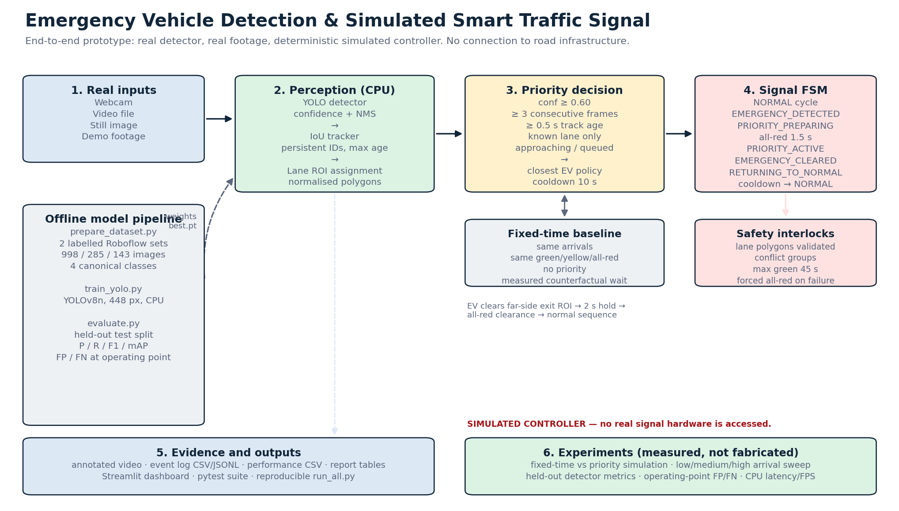
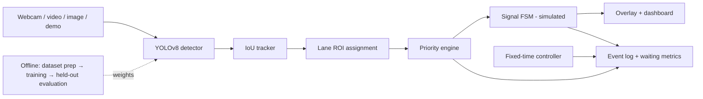
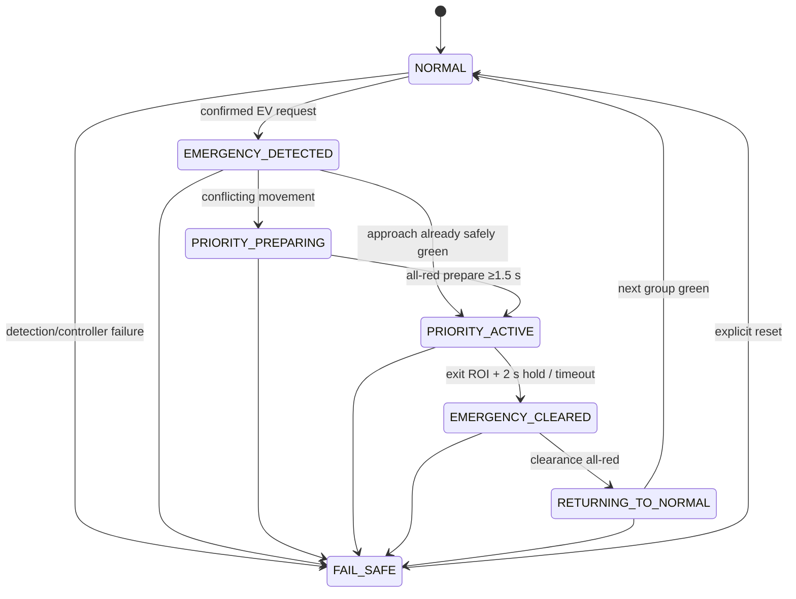

# Architecture

## 1. Purpose and scope

This document describes the software architecture of a **simulated**
emergency-vehicle signal-control prototype. The system has two independent
halves that meet through the same `SignalController` and `Intersection` objects:

1. **Perception path** — YOLO detection, IoU tracking, lane ROI assignment,
   priority confirmation, and live visualization on real footage.
2. **Experimental path** — a deterministic signal-level simulation that compares
   the fixed-time baseline with the proposed priority controller for identical
   vehicle arrivals.

The controller never writes to hardware. Its output is a rendered signal state,
an event log, and metrics.



The editable Mermaid equivalent of the main flow:



## 2. Modules

| Module | Responsibility |
|---|---|
| `src/detection/detector.py` | Loads a YOLO checkpoint, maps its class names to canonical project classes, exposes `emergency_capable`, and records inference latency. |
| `src/detection/tracker.py` | Dependency-free IoU tracker. Class-aware matching, `max_age_frames`, `min_hits`, short history. Optional ByteTrack path exists but requires `lap`. |
| `src/traffic/intersection.py` | Loads and validates lane/exit polygons, conflict groups, centre zone and normalised distance. Refuses conflicting simultaneous greens. |
| `src/traffic/lane_detector.py` | Assigns a track to an approach only when its centre is inside that approach polygon; majority-votes over recent frames; retains the last lane only while the vehicle is in the central junction. |
| `src/traffic/density.py` | Smoothed vehicle-count/occupancy density estimate (LOW/MEDIUM/HIGH). |
| `src/control/priority_engine.py` | Confirmation state per track, approach/queued test, candidate selection policy, event lifecycle, waiting-time measurement, cooldown and fail-safe release. |
| `src/control/signal_controller.py` | Guarded finite-state machine plus the fixed-time baseline controller. |
| `src/control/simulation.py` | Seeded arrivals, baseline and proposed runs, event-level CSV export, density sweep. |
| `src/evaluation/` | Detection metrics, FP/FN matching, latency recording, baseline-vs-proposed table generation. |
| `src/pipeline.py` | Wires all live components together and writes events/performance. |
| `dashboard/app.py` | Streamlit UI; live processing uses the same pipeline class as the CLI. |
| `scripts/` | Dataset preparation/audit, training, held-out evaluation, report generation, dashboard check. |

## 3. Perception path

### 3.1 Detection and class safety

The detector is a custom four-class YOLOv8n checkpoint:

```text
0 ambulance, 1 fire_engine, 2 police_vehicle, 3 normal_vehicle
```

Model class names are mapped through configurable aliases (`fire brigade`,
`fire truck`, `police car`, etc.). If the loaded checkpoint has no emergency
classes, the pipeline still runs but **priority activation is disabled** and a
`model_warning` event is written. This prevents a COCO model's "truck" class
from being treated as a fire engine.

### 3.2 Tracking

The default tracker matches detections to existing tracks by class-aware IoU
(threshold 0.30). Tracks survive up to 30 missed frames. A new track needs two
hits before it is considered confirmed. The tracker exports velocity, history,
displacement over a time window and lane distance for the decision layer.

ByteTrack/BoT-SORT can be selected in configuration but require the optional
`lap` package. The submitted environment uses the built-in IoU tracker so the
project installs without a compiled dependency.

### 3.3 Lane geometry

`config/intersection.yaml` defines four approach polygons, four far-side exit
polygons, a centre zone and the two conflict groups:

```text
north_south: north, south
east_west:   east, west
```

Coordinates are normalised `[0, 1]`. A detection centre outside every approach
is `UNKNOWN`; it never inherits a lane from image position. This is a deliberate
fail-safe: a wrong lane must not receive a green.

The interactive tool `tools/calibrate_lanes.py` edits the polygons for a new
camera and writes the same YAML file.

### 3.4 Confirmation and candidate selection

A track becomes an emergency candidate only when all conditions are true:

- class is emergency;
- confidence ≥ 0.60;
- at least 3 consecutive confident frames;
- track age ≥ 0.5 s;
- lane known from an approach ROI;
- distance to the junction centre is decreasing over the motion window, or the
  vehicle is already queued within 0.42 normalised distance.

Among simultaneous candidates, `closest` selects the smallest distance to the
junction. `confidence` and `arrival` policies are also implemented. Only one EV
owns priority at a time; a second EV waits in arrival order.

## 4. Signal control

### 4.1 Normal cycle

The normal cycle is built from the conflict groups:

```text
north_south green 20 s → north_south yellow 3 s → all-red 1 s
east_west green 20 s → east_west yellow 3 s → all-red 1 s
```

All values are configurable prototype parameters, not traffic-engineering
standards.

### 4.2 Priority lifecycle



Key invariants:

- `PRIORITY_ACTIVE` gives green only to the selected approach (or a
  non-conflicting same-group green when the approach was already green).
- Illegal jumps raise `InvalidTransition`.
- The controller validates that no two conflicting groups are green.
- `max_priority_seconds` (45 s) forces a release even if the EV is never seen
  leaving.
- Release always passes through an all-red clearance and a visible
  `RETURNING_TO_NORMAL` state.
- A 10 s cooldown starts at release.

### 4.3 Exit and release

For a north-approach vehicle, the far-side exit is the bottom zone (south side
of the frame). The naming follows the **approach**, not the physical side. When
the track centre enters the corresponding exit polygon, the engine records
`exit_seen_at`; after a 2 s hold it releases priority. If the tracker is lost,
a 3 s fail-safe timeout releases priority. This prevents an indefinitely held
green.

### 4.4 Fail-safe

Any exception in detection, tracking or controller update triggers
`force_fail_safe`: every lane is red, priority is disabled, and a `fail_safe`
event is logged. The state must be reset explicitly; it does not silently
resume.

## 5. Waiting-time definition

For the live pipeline:

```text
arrival_time = first confident detection assigned to an approach lane
waiting_time = actual priority green onset − arrival_time
baseline_wait = fixed-time next-green time for the same lane/arrival − arrival_time
```

For the simulation, the arrival time is the scheduled EV arrival and the
confirmation delay is 2 s. The baseline is computed by the same
`FixedTimeController` used by the live code. This keeps the comparison
consistent and avoids selecting a favourable baseline.

Priority response time is separately defined as:

```text
green onset − priority request time
```

It measures controller preparation, not detection latency. End-to-end wall-clock
latency from first lane-assigned detection to green is also recorded in the live
event log (`e2e_priority_latency_ms`).

## 6. Data and artifact flow

```text
data/raw/...                    scripts/prepare_dataset.py
      │                                  │
      └───────────────► data/dataset/ ───┼──► scripts/train_yolo.py ─► models/yolo/best.pt
                                         │                                  │
                                         └──► scripts/validate_dataset.py   │
                                                                            ▼
real footage ─► main.py / dashboard ─► src/pipeline.py ─► events + performance CSV
                                                                            │
config + seed ─► simulation.py ─► baseline/proposed CSV/JSON ─► scripts/generate_results.py
                                                                            │
                                                                            ▼
                                                              results/report_tables.md
```

`results/` is treated as evidence: files are produced by scripts, not edited by
hand. `run_all.py` records each command, return code and duration in
`results/logs/run_all_summary.json`.

## 7. Design trade-offs

| Choice | Reason | Cost |
|---|---|---|
| Custom four-class YOLOv8n at 448 px | Runs on CPU; small enough to train and demo | Lower accuracy than larger models; fire-engine data is scarce |
| IoU tracker | No compiled dependency; deterministic and easy to test | Less robust than ByteTrack under occlusion |
| Geometry-based lanes | Auditable and camera-agnostic after calibration | Requires per-camera calibration; schematic default is not a real intersection |
| One EV at a time | Simple safety argument and measurable events | A second EV may wait behind the first |
| Signal-level simulation | Reproducible and directly comparable | Does not model queues, spillback, pedestrians or driver behaviour |
| Fixed-time baseline with next-green calculation | Same arrival times; no lucky/unlucky random baseline | Baseline is an idealised fixed cycle, not a field-optimized plan |
